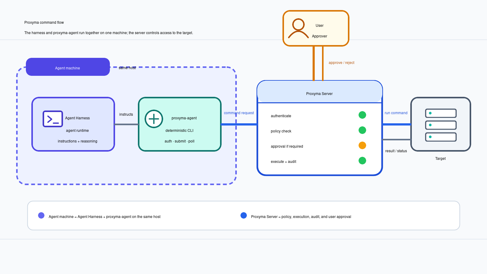

<p align="center">
  
</p>

<h1 align="center">Proxyma</h1>

<p align="center">
  A policy-enforcing proxy for managing AI agent access to remote systems.
</p>

## Why Proxyma

Giving an autonomous agent direct credentials or administrative access to a
production machine is dangerous. Proxyma places a controlled boundary between
the agent and the target: the agent asks Proxyma to run a command, and Proxyma
authenticates the caller, authorizes the target, evaluates command policy,
requests human approval when required, and performs the remote execution
without disclosing target credentials to the agent.

A typical use case is an operations agent that needs to inspect or maintain
Linux and Windows servers. The agent knows the target hostname or IP and the
work it needs to perform, while Proxyma owns the target connection details,
credentials, command policy, audit state, and approval channel.

<!-- START doctoc generated TOC please keep comment here to allow auto update -->
<!-- DON'T EDIT THIS SECTION, INSTEAD RE-RUN doctoc TO UPDATE -->

- [How It Works](#how-it-works)
- [Proxyma Dashboard](#proxyma-dashboard)
- [Supported Capabilities](#supported-capabilities)
  - [Feature Capabilities](#feature-capabilities)
  - [Technical Capabilities](#technical-capabilities)
- [Installation](#installation)
  - [Proxyma Server installation options](docs/proxyma-server-installation.md)
  - [`proxyma-agent` release installation](docs/proxyma-agent-installation-release.md)
  - [`proxyma-agent` source installation](docs/proxyma-agent-installation-source.md)
- [Repository Layout](#repository-layout)
- [Proxyma Server Runtime Configuration](#proxyma-server-runtime-configuration)
- [Agent Harness](#agent-harness)
- [Documentation](#documentation)
- [License](#license)

<!-- END doctoc generated TOC please keep comment here to allow auto update -->

## How It Works

<p align="center">
  
</p>

The complete command workflow is:

1. The harness decides that it needs to run a specific command on a target.
2. During proxyma-agent installation, select the Codex or Claude Code adapter
   so the harness knows when and how to use the `proxyma-agent` CLI. If no
   adapter is selected, copy the matching skill from `harness/` into the
   project-root discovery directory.
3. Before the first command for a target in the current session, the harness
   requests that target's blacklist and whitelist guidance with
   `proxyma-agent policy --target`. It reuses the guidance for that target until
   the harness restarts.
   This gives the harness enough context to select an exact pre-approved command
   template instead of an equivalent wrapper or script that would require
   approval. The server remains authoritative and checks the submitted command
   independently.
4. The harness uses `proxyma-agent` to authenticate, resolve the target, and
   submit the command to the Proxyma Server. The request contains the target
   identity, canonical command, and reasoning, but not the target credentials.
5. The Proxyma Server authenticates the agent and verifies that the agent is
   authorized to use the target.
6. The Proxyma Server resolves the target's connection details and evaluates
   the target's assigned command policies.
7. If the policy denies the command, the server blocks the task and returns the
   denial to the agent.
8. If the policy requires approval, the server creates a pending interaction
   and asks the configured human-interaction provider for a decision. The
   current providers are the built-in local console and NTFY.
9. A user approves or rejects the request. Approval continues the workflow;
   rejection or expiration blocks the task.
10. For an allowed or approved command, the Proxyma Server executes it against
   the target using its stored connection details, without exposing those
   credentials to the agent.
11. The server persists the task, command result, status, and audit information.
   The harness polls through `proxyma-agent` until it receives the final
   status, stdout, stderr, and exit status.

See the [detailed usage flow](docs/proxyma-typical-usage-flow.md) for the complete lifecycle.  

<table>
  <tr>
    <td bgcolor="#e8f4ff"><strong>Note</strong><br>
    The <code>proxyma-agent</code> CLI was introduced to improve speed and token
    consumption. Providing the API to the harness (as a skill) imposes a high
    and unnecessary burden on the harness, which results in poor performance.
    No MCP server is provided for a similar reason.</td>
  </tr>
</table>

> [!WARNING]
> **Early-stage project** 
Proxyma is currently at version **0.1** and has limited freature such as limited policy set and communication channels (currently only NTFY). Installation was tested mainly on Linux. Version provided for Windows or Mac were currently not tested.
 

## Proxyma Dashboard and Demo Video

The browser dashboard is used to manage users, agents, targets, policies, and
human-interaction instances.

<p align="center">
  
</p>

### Demo Video
[Watch the Proxyma demo](https://github.com/ascemama/proxyma/issues/47)

## Supported Capabilities

### Feature Capabilities

| Area | Support |
| --- | --- |
| Agent command execution | Agents submit target commands through `proxyma-agent`; they do not connect directly to targets. |
| Target management | Configure targets, authorized agents, target owners, transports, and credentials. |
| Human approval | Built-in local-console approval and remote NTFY approval requests/responses. No other interaction channels are currently supported. |
| Command policy | Each target uses one user-owned policy containing typed blacklist/whitelist rules and an optional LLM fallback; unmatched commands require approval. JSON rule lists can be imported into existing policies. |
| Durable tasks | Persist task state, status history, results, exit status, and safe command metadata for polling and recovery. |
| Audit and history | Persist command tasks and human interactions, then provide unified searchable history through the dashboard. |
| Administration | Manage users, agents, targets, policies, and interaction instances through the browser GUI or `proxymactl`. |

Policy rules use one of two effects: `allow` or `deny`. Rules are typed command
templates such as `ping {ipv4}` or `systemctl status {service}`. Policies are
owned by their creating user, reusable by other users, and assigned to targets.
Each target has one assigned policy. Within that policy, deny takes precedence
over allow. If no deterministic rule matches, the optional LLM profile is asked
to return a strict JSON decision; invalid, unavailable, or uncertain responses
fall back to human approval. The WebGUI can append a blacklist/whitelist JSON
rule list to an existing policy.

### Technical Capabilities

| Area | Support |
| --- | --- |
| Remote transports | SSH and WinRM. |
| Target environments | Linux shell, Windows shell over SSH, and Windows PowerShell over WinRM. |
| Target authentication | Passwords and unencrypted SSH private keys; WinRM uses password authentication with NTLM. |
| Agent authentication | Short-lived HS256 JWTs signed with an Agent JWT Signing Key. |
| User authentication | Argon2id passwords, persisted cookie sessions, CSRF protection, activation links, and password-reset links. |
| Server transport security | HTTPS with an automatically managed self-signed certificate or an operator-provided certificate and key; explicit HTTP mode for local development. |
| Persistence | SQLite-backed canonical command and interaction records with unified searchable history; JSON stores configuration resources. |
| Agent platforms | Windows, Linux, and macOS installers for the cross-platform `proxyma-agent` CLI. |


## Installation

Choose the Proxyma Server installation guide that matches the environment. Each
linked guide covers prerequisites, installation, verification, updates,
rollback, backup, troubleshooting, and removal.

| Installation type | Component | Intended use | Documentation |
| --- | --- | --- | --- |
| Local development | `proxyma-server` | Change or test the Go server and React frontend | [Proxyma Server — local development](docs/proxyma-server-installation-local.md) |
| Precompiled Linux binary | `proxyma-server` | Recommended host-level Linux server installation without a compiler or source checkout | [Proxyma Server — precompiled Linux](docs/proxyma-server-installation-linux-precompiled.md) |
| Source-built Linux binary | `proxyma-server` | Build and install a selected source revision on Linux | [Proxyma Server — source-built Linux](docs/proxyma-server-installation-linux-binary.md) |
| Docker | `proxyma-server` | Run the server and embedded frontend in a container | [Proxyma Server — Docker](docs/proxyma-server-installation-docker.md) |
| Release installation | `proxyma-agent` | Install the official cross-platform agent CLI, matching harness, and model adapter | [`proxyma-agent` release installation](docs/proxyma-agent-installation-release.md) |
| Source installation | `proxyma-agent` | Build and install the agent CLI and matching harness from a selected source revision | [`proxyma-agent` source installation](docs/proxyma-agent-installation-source.md) |

After installation, follow the [Proxyma Server first-time configuration guide](docs/first-time-configuration-proxyma-server.md)
to create the initial policy, interaction, agent, and target resources, then
follow the [Proxyma Agent first-time configuration guide](docs/first-time-configuration-proxyma-agent.md)
to configure the workstation harness and signing key.

## Repository Layout

```text
.github/workflows/         Release and container automation
cmd/proxyma/               Proxyma server entry point
cmd/proxyma-agent/         Cross-platform deterministic agent harness CLI
cmd/proxymactl/            Administrator CLI entry point
deploy/systemd/            Linux systemd service definition
docs/                      Proxyma Server installation, operation, API, and architecture guides
frontend/                  React/Vite GUI, shared logo, and browser tests
harness/                   Agent instruction pack, adapters, schemas, and examples
internal/                  Go implementation packages
docs/examples/             Checked-in policy and rule-list examples
schemas/                   JSON Schemas for configuration records
scripts/                   Build, install, release, test, and uninstall scripts
tests/                     Service-level fixtures and end-to-end tests
Dockerfile                 Production container build
proxyma.config.example.json Exhaustive runtime configuration example
```

Targets, policies, agents, users, interaction instances, secrets, TLS material,
and `var/proxyma/` state are runtime data. The default local entity and runtime
directories are all below `var/proxyma/`; source-controlled examples live under
`docs/examples/` and are never loaded automatically.

## Proxyma Server Runtime Configuration

Proxyma loads settings in increasing order of precedence:

```text
hardcoded defaults < proxyma.config.json < PROXYMA_* environment variables < CLI arguments
```

Copy [proxyma.config.example.json](proxyma.config.example.json) to
`proxyma.config.json` for an exhaustive file-based configuration. The following
arguments are the highest-precedence runtime overrides:

| Argument | Default | Purpose |
| --- | --- | --- |
| `--config` | `proxyma.config.json` | Use an explicit JSON configuration file; a missing explicit file is an error. |
| `--no-config` | `false` | Ignore the default JSON configuration file. |
| `--listen` | `127.0.0.1:8080` | HTTP or HTTPS listen address. |
| `--scheme` | `https` | Server scheme: `https` or explicit development mode `http`. |
| `--tls-mode` | `self_signed` | HTTPS certificate mode: `self_signed` or `provided`. |
| `--tls-cert-file` | `tls/self-signed.crt` | Active certificate or PEM full-chain path. |
| `--tls-key-file` | `tls/self-signed.key` | Matching unencrypted PEM private-key path. |
| `--tls-server-name` | empty | Additional DNS name or IP for a generated certificate SAN. |
| `--target-dir` | `var/proxyma/targets` | Target JSON directory. |
| `--policy-dir` | `var/proxyma/policies` | Command policy JSON directory. |
| `--agent-dir` | `var/proxyma/agents` | Agent JSON directory. |
| `--user-dir` | `var/proxyma/users` | User JSON directory. |
| `--database-path` | `var/proxyma/database.db` | Canonical SQLite database for commands, interactions, and history. |
| `--interaction-config-dir` | `var/proxyma/interaction_instances` | Interaction instance configuration directory. |
| `--user-session-dir` | `var/proxyma/user_sessions` | Persisted user session directory. |
| `--credential-token-dir` | `var/proxyma/credential_tokens` | Hashed activation and password-reset token directory. |
| `--llm-profile-dir` | `var/proxyma/llm_profiles` | Protected server-side LLM profiles and API keys. |
| `--known-hosts-path` | `var/proxyma/.ssh/known_hosts` | Proxyma-owned OpenSSH host-key trust file. |
| `--command-timeout` | `5m` | Default command execution timeout using Go duration syntax. |
| `--interaction-timeout` | `24h` | Pending human-interaction timeout using Go duration syntax. |
| `--user-session-ttl` | `12h` | GUI and user API session lifetime. |
| `--user-activation-token-ttl` | `12h` | Default activation-link lifetime. |
| `--user-activation-token-max-ttl` | `48h` | Maximum administrator-selected activation-link lifetime. |
| `--output-limit` | `1048576` | Maximum captured bytes for stdout or stderr before truncation. |
| `--require-command-approval` | `true` | Require approval when no explicit command policy evaluator is available. |
| `--debug` | `false` | Log HTTP requests, request bodies, command execution details, and LLM prompts/responses plus justifications; API keys are never logged. |

Environment-variable names and JSON field mappings are listed in
[Configuration](docs/configuration.md). Run `proxyma --version` to inspect an
installed server binary without starting it.

Commands and interactions are stored in SQLite; migrations run automatically.
See [Database operations](docs/database-operations.md) for backup, restore, and
safe reset procedures.

## Agent Harness

The cross-platform `proxyma-agent` CLI gives existing agent runtimes one
deterministic interface for Proxyma authentication, target resolution, command
submission, polling, duplicate prevention, and durable client task state. Agents:

- route target-machine commands through Proxyma instead of connecting directly;
- run `proxyma-agent resume` before new remote work;
- run `proxyma-agent policy --target=<hostname-or-ip>` before the first command
  for each target in a harness session;
- supply only target identity, remote payload, and reasoning;
- interpret results and decide when the logical user goal is complete.

GitHub releases include verified user-local installers for Windows, Linux, and
macOS. They select the native executable and install the matching sanitized
harness package and selected adapter from the same release; see the
[`proxyma-agent` release installation guide](docs/proxyma-agent-installation-release.md).

Start with the
[harness instruction pack](harness/instruction-pack/proxyma-harness.md),
and [CLI authentication guide](harness/instruction-pack/auth/proxyma-auth.md). The
[harness configuration schema](harness/instruction-pack/proxyma-agent.schema.json),
[task-state schema](harness/instruction-pack/task-state.schema.json),
[examples](harness/examples/), and
[validation instructions](harness/tests/README.md) support integrations. A
[Codex project skill](harness/.agents/skills/proxyma-harness/SKILL.md) and a
[Claude Code project skill](harness/.claude/skills/proxyma-harness/SKILL.md) are
included in the shared harness. Pass `--harness-type codex` or
`--harness-type claude` to the agent installer to place the selected skill at
the project-root discovery path. If the option is omitted, copy the desired
skill into `.agents/skills/proxyma-harness/` for Codex or
`.claude/skills/proxyma-harness/` for Claude Code, then restart the harness.
Harness v1 state and run configuration are intentionally unsupported.

## Documentation

- [First-time Proxyma Server configuration](docs/first-time-configuration-proxyma-server.md)
- [First-time Proxyma Agent configuration](docs/first-time-configuration-proxyma-agent.md)
- [Proxyma Server installation overview](docs/proxyma-server-installation.md)
- [`proxymactl` command reference](docs/proxymactl-command-reference.md)
- [`proxyma-agent` release installation](docs/proxyma-agent-installation-release.md)
- [Release artifact testing](docs/release-testing.md)
- [`proxyma-agent` source installation](docs/proxyma-agent-installation-source.md)
- [Configuration records and runtime settings](docs/configuration.md)
- [User and agent API usage](docs/api.md)
- [Build and version metadata](docs/build-version.md)
- [Typical command lifecycle](docs/proxyma-typical-usage-flow.md)
- [Interaction architecture](docs/interaction-architecture.md)
- [Interaction-provider integration](docs/interaction-integration.md)
- [Storage integration](docs/store-integration.md)

## License

Proxyma is free and open-source software distributed under the GNU Affero
General Public License version 3 only (`AGPL-3.0-only`). See [LICENSE](LICENSE)
for the full terms and [CONTRIBUTING.md](CONTRIBUTING.md) for the contribution
policy. The official container image carries the same license and links each
release to its corresponding source code.
