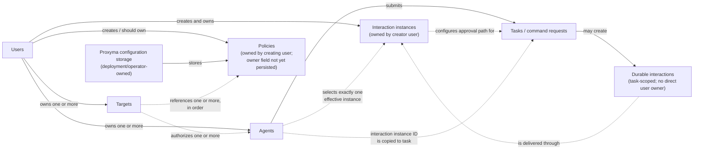
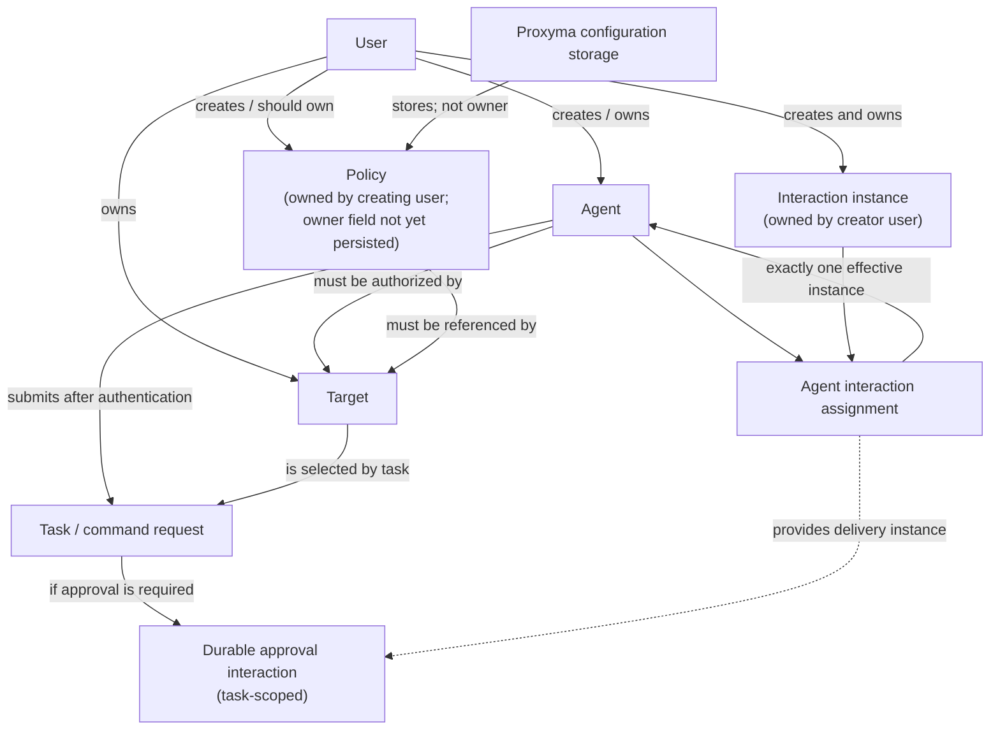

# Proxyma Entity Dependencies

This document describes how the main Proxyma management entities relate to one
another. It distinguishes ownership from authorization and from a simple
reference. That distinction is important because an entity may be allowed to
use another entity without owning it.

## Current entity relationships

In the diagram, solid arrows represent ownership or lifecycle containment.
Dashed arrows represent references, authorization, or delivery selection.

The ownership answers are therefore explicit:

- **Policies:** the user who creates a policy should own it. The current policy
  schema does not persist `creator_user_id` or `user_ids`, so this ownership is
  currently implicit and cannot yet be enforced reliably.
- **Interaction instances:** exactly one user owns a non-local instance through
  `creator_user_id`. Multiple agents may reference that instance.
- **Durable interactions:** these are approval records created for a task. They
  belong to the task lifecycle and are not directly owned by the user who
  eventually responds.

The interaction instance is therefore the bridge between management and
execution: a user creates and owns it, an agent selects it, and tasks use it to
route approval requests. The instance does not own the task or the approval
record.

### Relationship rules

| Relationship | Current rule |
| --- | --- |
| User → Agent | An agent must have at least one owning user. Multiple users may own the same agent. |
| User → Target | A target must have at least one owning user. Multiple users may own the same target. |
| Target → Agent | A target lists one or more agents authorized to submit commands to it. This is authorization, not ownership. |
| Target → Policy | A target lists one or more policy IDs. The list order is meaningful when policy priority and rule order are evaluated. |
| Policy → User | The creating user should own the policy, but the current policy schema does not persist an owner reference. |
| User → Interaction instance | A non-local interaction instance has exactly one `creator_user_id`. That user owns the instance. The built-in `local` instance is a singleton and has no user owner. |
| Agent → Interaction instance | Each agent has exactly one effective interaction instance: an explicit instance or the built-in `local` instance. An instance may be referenced by zero or more agents. |
| Task → Interaction | A task may create one durable approval interaction. The interaction records the selected instance ID and belongs to the task lifecycle. |

## Management and creation dependencies

An interaction instance does not need an agent to exist before it is created.
It needs its creator user. The agent must exist before an interaction instance
can be assigned to that agent. Likewise, a target can only be fully usable once
its referenced users, agents, and policies exist.

## Ownership versus access

The current model should be read using these rules:

- Ownership controls which users may manage an entity.
- Agent authorization controls which agents may submit commands to a target.
- A target's policy references control which command rules are evaluated.
- An agent's interaction assignment controls where approval requests are sent.
- None of these relationships gives an agent permission to answer an approval;
  only the configured human interaction provider may return the human response.

## Policy ownership implementation gap

Policies are intended to follow the same ownership model as interaction
instances: the user who creates one should be recorded as its owner. They
currently do not contain `user_ids` or `creator_user_id`; they are loaded as
shared policy files and targets reference them by ID. This makes policy reuse
easy, but it also means the current implementation cannot distinguish the
creator from another user who merely has permission to manage policies.

The likely implementation is:

1. Add `creator_user_id` or `owner_user_id` to the policy model.
2. Restrict normal users to policies they own or that are explicitly shared with
   them.
3. Allow policies to be attached to multiple targets.
4. Add an explicit global/system scope for administrator-managed baseline rules.

For approval-time rule creation, “this target only” should attach a user-owned
policy rule to one target, while “all targets I own” should attach the same
user-owned policy to the user's targets. The underlying rule should still have
a stable ID, an audit history, and an optional expiration time.
