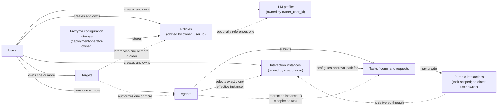
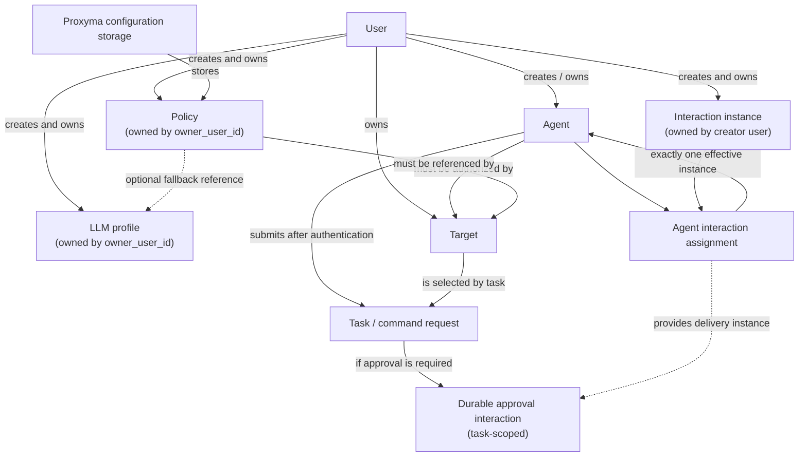

# Proxyma Entity Dependencies

This document describes how the main Proxyma management entities relate to one
another. It distinguishes ownership from authorization and from a simple
reference. That distinction is important because an entity may be allowed to
use another entity without owning it.

In local development, the mutable entity records are stored under
`var/proxyma/targets/`, `var/proxyma/agents/`, `var/proxyma/users/`,
`var/proxyma/policies/`, and `var/proxyma/interaction_instances/`. The durable
task and approval records are stored separately under `var/proxyma/tasks/` and
`var/proxyma/interactions/`. Files under `docs/examples/` are source-controlled
examples and are not persistent entities.

## Current entity relationships

In the diagram, solid arrows represent ownership or lifecycle containment.
Dashed arrows represent references, authorization, or delivery selection.

The ownership answers are therefore explicit:

- **Policies:** the creating user is persisted as `owner_user_id`. The policy
  remains reusable by other authenticated users, but only its owner or an
  administrator may edit, import rules, or delete it.
- **Interaction instances:** exactly one user owns a non-local instance through
  `creator_user_id`. Multiple agents may reference that instance.
- **Durable interactions:** these are approval records created for a task. They
  belong to the task lifecycle and are not directly owned by the user who
  eventually responds.
- **LLM profiles:** provider configuration and API keys are owned by their
  creating user. Policies may reference a profile that the policy editor is
  allowed to use; the key is never exposed through the API or an interaction.

The interaction instance is therefore the bridge between management and
execution: a user creates and owns it, an agent selects it, and tasks use it to
route approval requests. The instance does not own the task or the approval
record.

### Relationship rules

| Relationship | Current rule |
| --- | --- |
| User → Agent | An agent must have at least one owning user. Multiple users may own the same agent. |
| User → Target | A target must have at least one owning user. Multiple users may own the same target. |
| Target → Agent | A target lists one or more agents authorized to submit commands to it. This is authorization, not ownership. |
| Target → Policy | Each target references exactly one policy ID. A policy can be shared by many targets; assigning a different policy replaces the current assignment. |
| Policy → User | `owner_user_id` identifies the single user who owns and manages the policy. |
| Policy → LLM profile | An enabled policy may reference one reusable profile; the profile remains owned by its creating user. |
| User → LLM profile | A profile has exactly one owner and stores its provider API key in protected server-side storage. |
| User → Interaction instance | A non-local interaction instance has exactly one `creator_user_id`. That user owns the instance. The built-in `local` instance is a singleton and has no user owner. |
| Agent → Interaction instance | Each agent has exactly one effective interaction instance: an explicit instance or the built-in `local` instance. An instance may be referenced by zero or more agents. |
| Task → Interaction | A task may create one durable approval interaction. The interaction records the selected instance ID and belongs to the task lifecycle. |

## Management and creation dependencies

An interaction instance does not need an agent to exist before it is created.
It needs its creator user. The agent must exist before an interaction instance
can be assigned to that agent. Likewise, a target can only be fully usable once
its referenced users, agents, and policies exist.

## Ownership versus access

The current model should be read using these rules:

- Ownership controls which users may manage an entity.
- Agent authorization controls which agents may submit commands to a target.
- A target's policy references control which command rules are evaluated.
- A policy's optional LLM profile reference controls which provider is asked
  after deterministic rules do not match.
- An agent's interaction assignment controls where approval requests are sent.
- None of these relationships gives an agent permission to answer an approval;
  only the configured human interaction provider may return the human response.

## Policy management V1

Policies contain typed blacklist and whitelist command templates. They are
shared read/use entities: users may attach a policy to targets they own, while
the owner or an administrator may edit, import rule lists, or delete it. A
each target references one policy. Deny wins over allow within that policy,
and an unmatched command requires approval.

Rule-list JSON files are import inputs only. They contain `blacklist` and
`whitelist` arrays and are appended to an existing policy through the WebGUI;
they do not contain policy ownership, target assignments, or credentials.

An LLM profile is a separate reusable entity. It contains provider metadata and
server-side credentials; the policy stores only the profile reference and its
prompt. Deterministic deny/allow rules are evaluated first, and any invalid or
uncertain LLM result falls back to approval.
