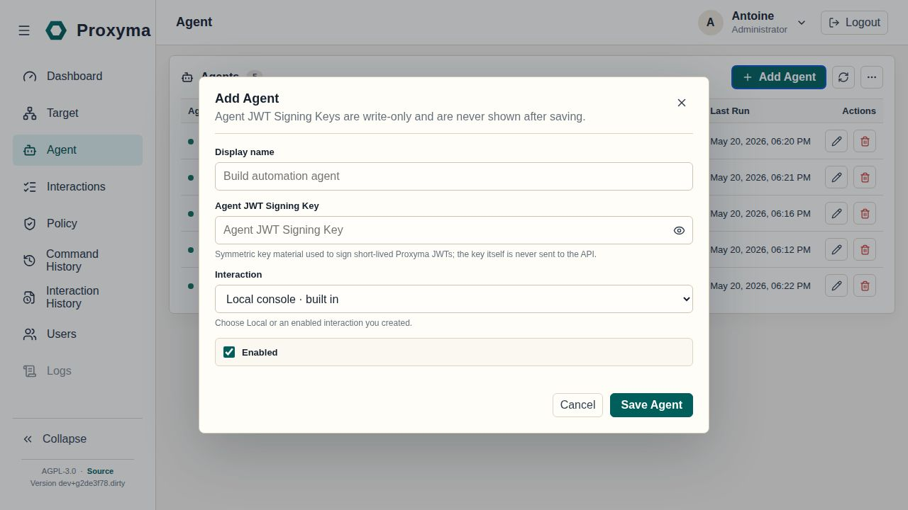

# First-time Proxyma Client Configuration

This guide configures `proxyma-client` after the client executable and matching
harness have been installed. The Proxyma server and agent normally run on
different machines: the server owns the agent record and signing key, while
the workstation running Codex or Claude Code stores the client configuration.

Before starting, complete one of the installation guides:

- [`proxyma-client` release installation](proxyma-client-installation-release.md)
- [`proxyma-client` source installation](proxyma-client-installation-source.md)

Use the same release or source revision for the executable and harness. Do not
copy a harness from a different version.

## Where the harness belongs

The harness belongs in the project directory where Codex or Claude Code will
work. Run the installer from that directory, or pass it explicitly with
`--project-dir`/`-ProjectDir`:

~~~text
your-project/
├── .agents/                    If Codex is selected
│   └── skills/proxyma-harness/SKILL.md
├── .claude/                    If Claude Code is selected
│   └── skills/proxyma-harness/SKILL.md
└── harness/
    ├── agent-configuration/
    │   └── agent.json
    ├── instruction-pack/
    ├── task-state/
    └── proxyma-client.json
~~~

On a release or source installation, the installer creates `harness/` under
the selected project directory. Pass `--harness-type codex` (or
`-HarnessType Codex`) to install the Codex skill at
`.agents/skills/proxyma-harness/SKILL.md`, or use `claude` to install it at
`.claude/skills/proxyma-harness/SKILL.md`. Do not put the harness beside the
client executable in `$HOME/.local/bin` or
`%LOCALAPPDATA%\Programs\Proxyma\bin`.

If no harness type was supplied, copy the adapter for the harness you use:

~~~bash
# Codex
mkdir -p .agents/skills/proxyma-harness
cp ./harness/.agents/skills/proxyma-harness/SKILL.md \
   ./.agents/skills/proxyma-harness/SKILL.md

# Claude Code
mkdir -p .claude/skills/proxyma-harness
cp ./harness/.claude/skills/proxyma-harness/SKILL.md \
   ./.claude/skills/proxyma-harness/SKILL.md
~~~

On Windows, use the equivalent `New-Item` and `Copy-Item` commands. Restart
Codex or Claude Code after installing or copying the skill.

The adapters reference `harness/instruction-pack/` from the project root. Keep
the shared `harness/` directory beside `.agents/` or `.claude/`; do not copy
only `SKILL.md` into an otherwise empty project or move `instruction-pack/`
inside the adapter directory.

For example, to install into an existing project on Linux or macOS:

~~~bash
bash ./install-proxyma-client.sh --project-dir /path/to/your-project
~~~

On Windows PowerShell:

~~~powershell
powershell.exe -NoProfile -ExecutionPolicy Bypass `
  -File .\install-proxyma-client.ps1 `
  -ProjectDir C:\path\to\your-project
~~~

The client CLI looks for `harness/proxyma-client.json` by searching upward from
the current working directory. Therefore, run it from the project directory or
one of its subdirectories. You can also select a configuration explicitly with
`--config` before the command, or set `PROXYMA_HARNESS_CONFIG`.

## 1. Set the Proxyma server URL

Edit `your-project/harness/proxyma-client.json` and replace the example server
URL. This is the URL of the running Proxyma server, not the workstation where
the agent is installed:

~~~json
{
  "schema_version": "2",
  "proxyma_base_url": "https://proxyma.example",
  "agent_config": "agent-configuration/agent.json",
  "state_dir": "task-state",
  "http_timeout_seconds": 15,
  "lock_timeout_seconds": 5,
  "active_poll_interval_seconds": 30
}
~~~

For a local development server, use a URL such as
`http://127.0.0.1:8080`. The URL must be reachable from the agent
workstation and must begin with `http://` or `https://`. The
`agent_config` and `state_dir` paths are relative to the directory containing
this file. Keep `task-state` under `harness/`; it is owned by the CLI and must
not be edited manually.

## 2. Create the server-side agent record

In the Proxyma server GUI, open **Agent**, select **Add Agent**, and:

1. Give the agent a descriptive name.
2. Generate or enter a strong **Agent JWT Signing Key**.
3. Assign the ntfy interaction or keep **Local console · built in**.
4. Save the agent.
5. In the **Agent created** dialog, use **Copy configuration** to copy the
   generated JSON, which contains the Agent ID and signing key.

The generated Agent ID and signing key must be copied exactly. The signing key
is write-only and the generated configuration is not shown again after the
dialog is closed, so save it in the harness configuration and in a password
manager or another approved secret store before selecting **Done**. The
server-side agent must also be owned by the user who will use it and assigned
to the required targets.

For the complete server-side policy, interaction, agent, and target setup, see
[First-time Proxyma Server Configuration](first-time-configuration-proxyma-server.md).

## 3. Add the client agent ID and signing key

Create the local credential file from the packaged placeholder. Run this from
the project directory, then paste the JSON copied from the **Agent created**
dialog into the new file:

~~~bash
cp ./harness/agent-configuration/agent.example.json \
   ./harness/agent-configuration/agent.json
~~~

Edit `harness/agent-configuration/agent.json` so it contains the UUID of the
server-side agent and the exact signing key entered in the server GUI:

~~~json
{
  "agent_id": "YOUR-PROXYMA-AGENT-UUID",
  "agent_jwt_signing_key": "THE-EXACT-SIGNING-KEY"
}
~~~

Do not use the agent display name in `agent_id`; it must be a UUID. Do not add
extra whitespace or line breaks to the signing key. Do not commit this file,
paste the key into a prompt, put it in an installer argument, or place it in a
command-line option.

Restrict the file to the user running the agent on Linux or macOS:

~~~bash
chmod 700 ./harness/agent-configuration
chmod 600 ./harness/agent-configuration/agent.json
~~~

On Windows, remove inherited access and grant the current user access through
the Security tab or an equivalent managed endpoint policy. For example:

~~~powershell
icacls .\harness\agent-configuration\agent.json /inheritance:r `
  /grant:r "$($env:USERNAME):(R,W)"
~~~

## Alternative: inject the signing key through the environment

For CI, managed workstations, or a system secret manager, keep only the agent
ID in `agent.json`:

~~~json
{
  "agent_id": "YOUR-PROXYMA-AGENT-UUID"
}
~~~

Set `PROXYMA_AGENT_JWT_SIGNING_KEY` in the environment of the process that
starts Codex or Claude Code. The environment value overrides the value in the
file, so do not configure two different keys.

Linux or macOS:

~~~bash
export PROXYMA_AGENT_JWT_SIGNING_KEY='THE-EXACT-SIGNING-KEY'
codex
~~~

Windows PowerShell:

~~~powershell
$env:PROXYMA_AGENT_JWT_SIGNING_KEY = "THE-EXACT-SIGNING-KEY"
codex
~~~

If Codex is already running, restart it after changing the environment. Never
use an inline secret in a command that may be recorded in shell history or
displayed in process listings. The CLI does not print the signing key or the
JWT it creates.

## 4. Protect local files from source control

The real credential file and durable task state are local runtime data. Add
these paths to the containing project's `.gitignore` if they are not already
ignored:

~~~gitignore
/harness/agent-configuration/*.json
!/harness/agent-configuration/agent.example.json
/harness/task-state/active/
/harness/task-state/blocked/
/harness/task-state/closed/
/harness/task-state/summaries/
/harness/task-state/.journal/
/harness/task-state/.proxyma-client.lock
~~~

The installer preserves `harness/proxyma-client.json`,
`harness/agent-configuration/`, and `harness/task-state/` during upgrades.
Back them up securely before changing or rolling back the installed release.

## 5. Validate the configuration

From the project directory, run:

~~~bash
proxyma-client version
proxyma-client doctor
proxyma-client resume
~~~

`doctor` checks the configuration file, credential file or injected secret,
state locking, server health, authentication, and the required server
capability. `resume` recovers interrupted local work and polls existing
non-final operations once.

To verify a target without submitting a command:

~~~bash
proxyma-client inspect --target server.example
~~~

Before the first command for a target in a harness session, retrieve its
current server-side policy guidance:

~~~bash
proxyma-client policy --target server.example
~~~

If discovery fails, run from the project or select the file explicitly:

~~~bash
proxyma-client --config ./harness/proxyma-client.json doctor
~~~

Common causes of authentication failure are a mistyped UUID, a signing key
that does not exactly match the server record, an unreachable server URL, a
wrong system clock, or an environment variable that was not inherited by the
process running Codex. Do not create a new server agent until those causes
have been checked.
