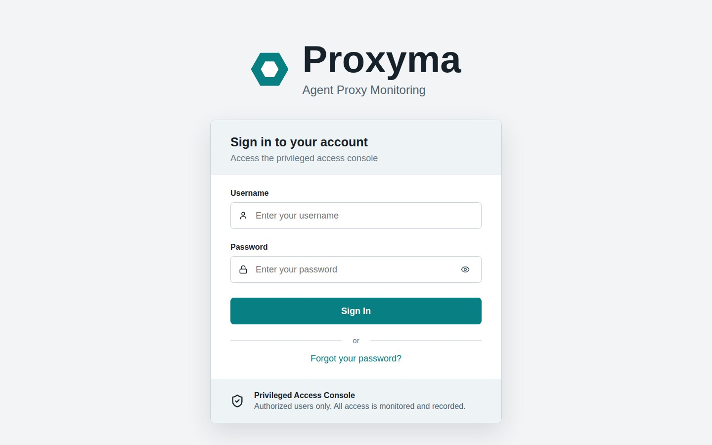
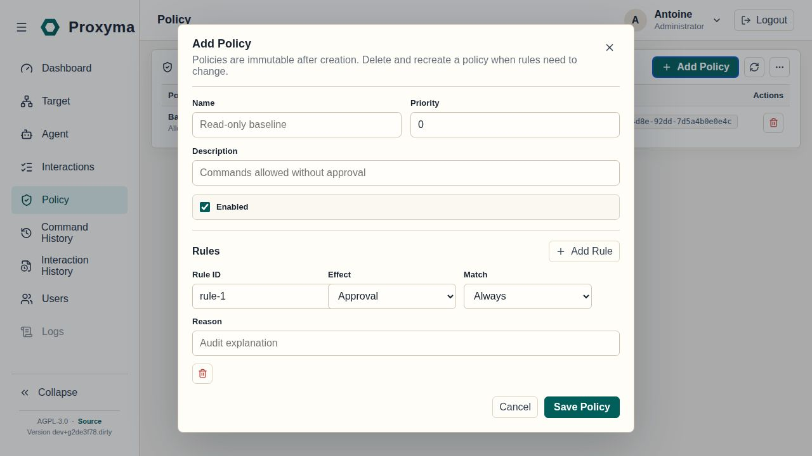
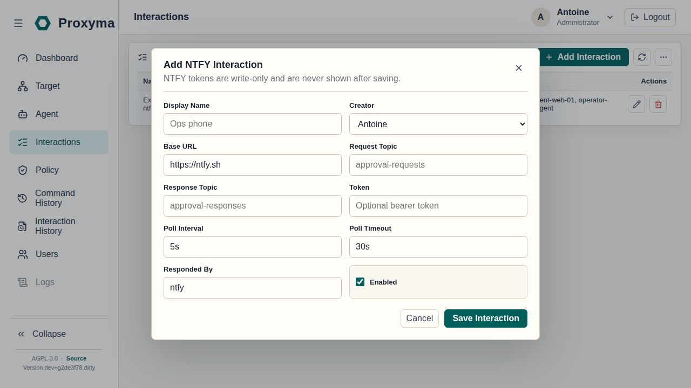
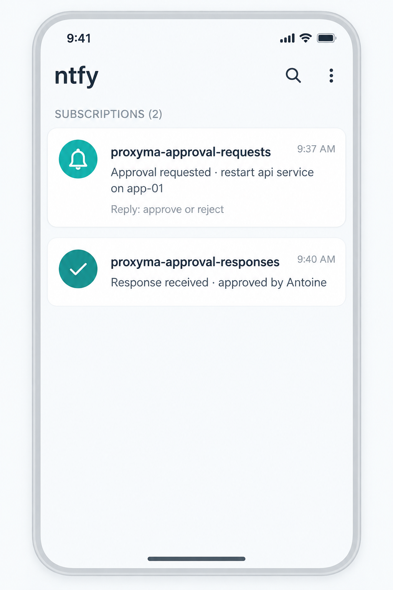
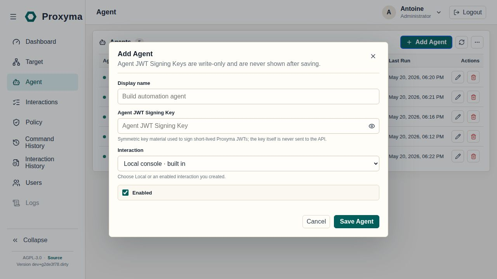
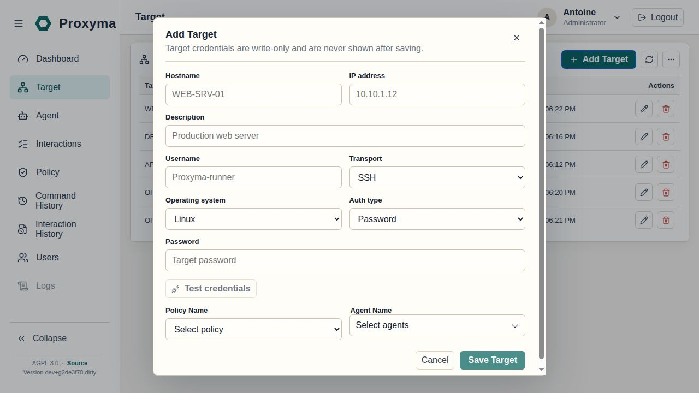
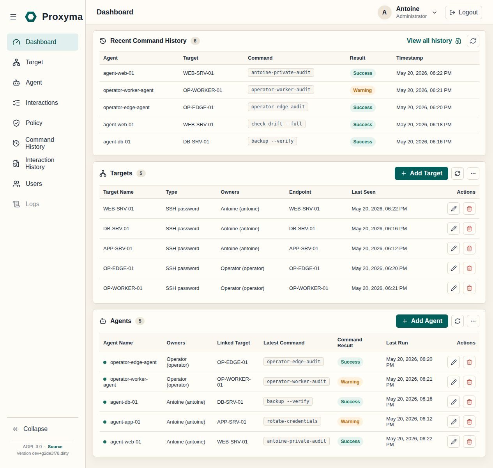

# First-time Configuration

This guide walks through the first browser-based Proxyma configuration in the
order that resources depend on one another:

1. Sign in.
2. Create a command policy.
3. Create an ntfy communication instance.
4. Create an agent.
5. Create a target.

The screenshots were captured from the local Proxyma server using the checked-in
end-to-end fixture data. The forms intentionally leave credentials and signing
keys blank; use your own secrets when configuring a real deployment.

## Before you begin

Start Proxyma and open its browser GUI. For local development, follow the
[local deployment guide](deployment-local.md). For an installed server, open
the HTTPS URL shown by the service and make sure the administrator user has
been created.

In a local source checkout, users, agents, targets, policies, and interaction
instance configuration are stored under `var/proxyma/`. Files under
`docs/examples/` are source-controlled examples only and are not loaded
automatically.

You will need:

- an administrator account;
- an SSH or WinRM target and credentials;
- a policy describing which commands are allowed or denied; unmatched commands require approval;
- an ntfy server and request/response topics if you want remote approval
  notifications.

## 1. Sign in

Open the Proxyma URL and sign in with your administrator username and password.

After a successful sign-in, the dashboard shows the resources visible to the
current user. The navigation on the left opens the Target, Agent, Interactions,
and Policy pages.

## 2. Create a policy

Open **Policy** in the left navigation and select **Add Policy**. Give the
policy a descriptive name, enable it, and add typed command templates to its
**Blacklist** and **Whitelist** sections. For example, `ping {ipv4}` allows a
ping to any IPv4 address while preserving the command structure.

Commands matching a blacklist rule are denied. Commands matching a whitelist
rule run without approval. Everything else creates the normal approval
interaction. Use **Import JSON** to append a prepared rule-list file to an
existing policy; the import never creates a separate policy.

Optionally, create an LLM profile from **Settings** before editing the policy.
The profile stores the provider API key on the Proxyma server and the key is
never returned through the API. Select it in the policy's LLM fallback section
and write a prompt such as “approve only commands that are clearly read-only
with very high certainty”. Deterministic rules are checked first; an invalid or
uncertain LLM response still requires approval.

Policies can be edited in place. Changes affect every target currently assigned
to the policy. Each target has exactly one policy; assigning a target to a
different policy replaces its current assignment. Target assignments are
managed from the policy detail page or the target editor.

## 3. Create an ntfy communication

Open **Interactions**, select **Add Interaction**, choose **NTFY**, and complete
the form:

- **Display Name** identifies the notification channel in Proxyma.
- **Base URL** is normally `https://ntfy.sh` or your self-hosted ntfy URL.
- **Request Topic** receives approval requests.
- **Response Topic** receives approval responses.
- **Token** is optional and is write-only after saving.
- **Poll Interval** and **Poll Timeout** control response polling.
- **Responded By** is the label recorded for the responder.

### Why are there two topics?

An ntfy topic is a stream of messages. Proxyma uses two streams because an
approval interaction has two directions:

- **Request Topic** is where Proxyma publishes a new approval request. Subscribe
  to this topic on the phone or desktop where an operator will review requests.
- **Response Topic** is where the operator's **Approve** or **Reject** action is
  sent. Proxyma listens to this topic and matches the response to the pending
  interaction.

Keeping these topics separate makes the direction of traffic clear and prevents
Proxyma's request notifications from being mixed with approval responses. Use
different, hard-to-guess topic names; do not use a public topic for production
approvals. The two topic fields are required by the NTFY interaction
configuration, and they should normally contain different topic names.

The example below is illustrative: the first subscription shows an approval
request and the second shows the response stream that Proxyma polls.

  

Test the topics and access token outside Proxyma first if your ntfy server
requires authentication. Proxyma does not display the token again after the
instance is saved.

## 4. Create an agent

Open **Agent** and select **Add Agent**. Enter a display name and generate or
paste a strong **Agent JWT Signing Key**. Select the ntfy interaction created in
the previous step, or keep **Local console · built in** if approvals should be
answered on the Proxyma server console.

Save the signing key in the agent's secret configuration at the same time. The
key is write-only in the GUI and is used to sign short-lived HS256 JWTs; it is
never sent as the bearer token itself. An agent must also be owned by the user
who will operate it.

## 5. Create a target

Open **Target** and select **Add Target**. Fill in the connection details:

- **Hostname** and/or **IP address** identify the remote machine.
- **Username**, **Transport**, and **Operating system** describe the connection.
- Select **Password** or **Private key** authentication and provide the
  corresponding secret.
- Select the command **Policy Name**.
- Select the **Agent Name** values that may use this target.

New targets must pass **Test credentials** before they can be saved. For an
unknown SSH host key, verify the displayed algorithm and SHA-256 fingerprint
through a trusted channel, then choose **Trust and retry**. Proxyma stores the
host key only after the authentication and test command succeed.

After saving, repeat this step for any additional servers. A target refers to
one policy and one or more agents; every referenced resource must exist and be
visible to the owning user. Assigning a different policy replaces the target's
current policy.

## Resulting dashboard

When at least two targets and their agents are configured, the dashboard gives
you a quick view of recent command history, target endpoints, and agent-to-target
links. The example below shows five fixture targets and five agents.

For the record formats, relationships, and CLI alternatives, see
[Configuration](configuration.md). For the complete command lifecycle, see the
[typical usage flow](proxyma-typical-usage-flow.md).
