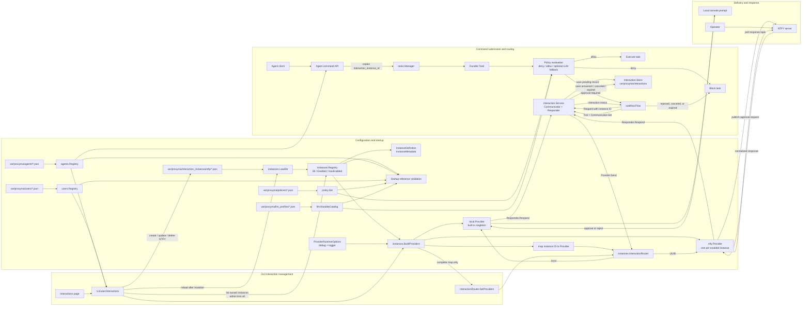

# Interaction Architecture

Proxyma separates interaction configuration, delivery, and durable approval state. Every agent has exactly one effective interaction instance: an explicit instance ID or the built-in `local` default. An interaction instance may be referenced by zero or more agents. The interaction service persists each request, and the interaction router sends it through the matching provider.

## Main Responsibilities

| Component | Responsibility |
| --- | --- |
| `interaction.Service` | Owns the durable interaction lifecycle: pending, answered, canceled, and expired. It implements both `Communicator` for callers and `Responder` for providers. |
| `instances.Registry` | Holds provider-neutral `InstanceDefinition` values loaded from interaction configuration files. `local` is implicit and is not a file-backed definition. |
| `instances.BuildProviders` | Converts enabled definitions into provider implementations. Provider-specific construction is contained in the interaction package. |
| `instances.InteractionRouter` | Selects a provider using `Interaction.InteractionInstanceID`, binds pending interactions to the provider generation that delivered them, and drains replaced providers before closing them. |
| `local.Provider` | Prompts on the Proxyma console and returns the operator response directly to `interaction.Service`. |
| `ntfy.Provider` | Publishes an approval message and polls the configured response topic only while it has pending interactions. Recovered pending interactions restart polling automatically. |
| `taskflow.Flow` | Requests approval when required, waits on the durable interaction status, then executes or blocks the task. |
| User management API | Manages user-owned policies, target assignments, and interaction configuration. Policy changes refresh the evaluator; interaction changes rebuild the provider map. |

Agent-authenticated HTTP clients can read interaction status but cannot answer an
interaction. Providers run inside Proxyma and return authenticated human responses through
the internal `Responder` interface, keeping command requesters separate from approvers.

## Important Data Flow

1. The authenticated agent's `interaction_instance_id` is copied into the submitted task. Missing agent configuration normalizes to `local`.
2. When policy requires approval, taskflow passes that instance ID to `interaction.Service.Request`.
3. The service persists the pending interaction before asking `InteractionRouter` to deliver it.
4. The service tracks the durable pending lifecycle with providers; answered, canceled, and expired interactions are untracked immediately.
5. The router uses the same provider generation for delivery and cancellation, including while an older configuration drains after a reload.
6. Providers return responses through the `Responder` interface; they do not approve tasks directly.

GUI users may newly assign `local` or an enabled interaction instance whose `creator_user_id` matches their user ID. Existing assignments owned by another user may be preserved while editing other agent fields, but cannot be newly selected after replacement.
7. Taskflow observes the persisted interaction status and decides whether to execute or block the task.

Policy decisions first use the deterministic blacklist and whitelist rules. A
matching blacklist rule denies the command; otherwise a matching whitelist rule
allows it. If no rule matches and the policy has an enabled LLM fallback, the
server sends the command plus the policy prompt to the selected profile. Only a
valid `approved` response allows execution; invalid, unavailable, or uncertain
responses require approval. The WebGUI/API is the only policy mutation path.
Interaction providers, including NTFY, only answer pending approval requests
and never modify policies.

Configuration reloads use build-then-swap behavior. If any provider cannot be constructed, `SetProviders` is not called and the active router configuration remains unchanged. After a successful swap, new interactions use the new providers while replaced providers continue serving their already-pending interactions and close after those interactions drain.

Historical interaction browsing and filtering is a separate GUI concern from provider
instance management. The proposed production query model is documented in
`docs/interaction-history-search-architecture.md`.
