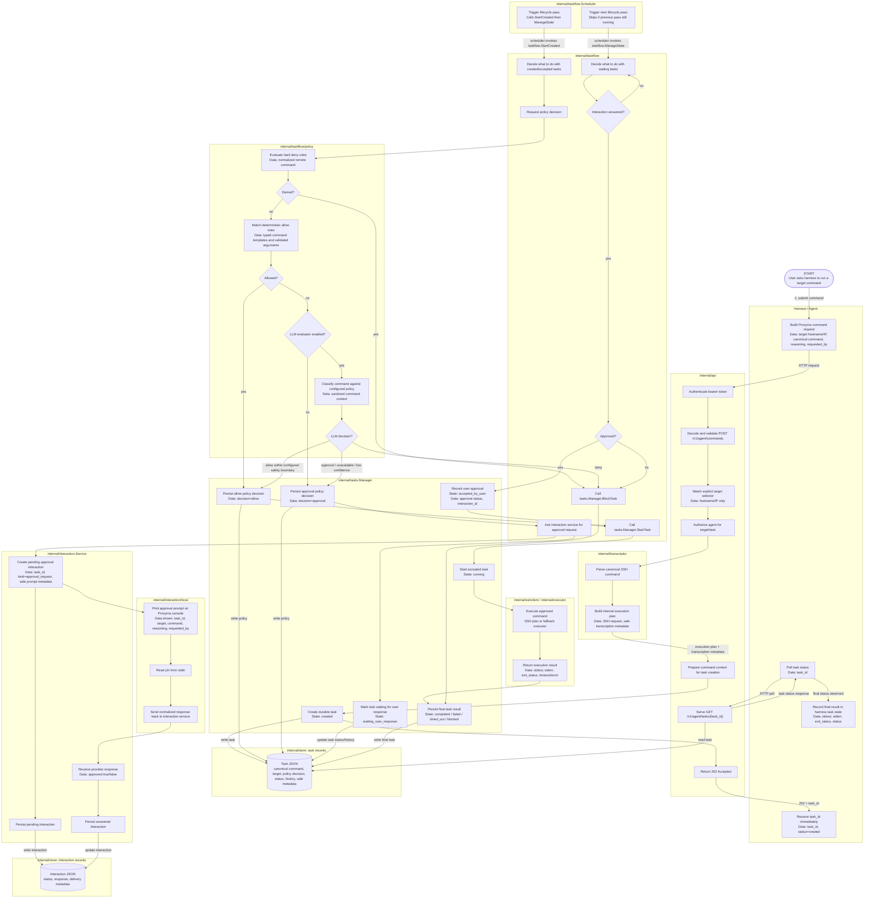

# Proxyma Typical Usage Flow

This editable Mermaid flow diagram shows what each Proxyma component does during a
typical harness-submitted command that is evaluated by target-owned command
policy before execution.

## Taskflow vs Tasks

`internal/taskflow` is the lifecycle policy layer. It looks at durable task
state, target-owned command policy, and interaction state, then decides the next
high-level transition: start directly, deny, request approval, wait for an
answer, apply an approval/rejection/expiration, or ask the task manager to
start/block a task. It also owns the scheduler loop that periodically invokes
those lifecycle decisions. It does not own task storage, task JSON shape, or
command execution.

`internal/tasks` is the task domain and runtime primitive layer. It owns the
durable `Task` model, task status constants, status history, approval fields,
policy decision fields, persistence-facing task operations, command execution,
and result recording.

The code is separated so policy decisions stay outside the task persistence and
execution primitive. That lets `tasks.Manager` remain the authoritative mutator
for task records, while `taskflow.Flow` can express Proxyma-specific lifecycle
policy such as "this target's policy allows, denies, or requires approval"
without embedding that policy into every low-level task operation. It also keeps
taskflow scheduling close to the lifecycle policy it periodically invokes.

## Flow vs Scheduler vs Manager

The flow, scheduler, and manager have different roles:

- `tasks.Manager` owns task state changes and command execution. It creates
  tasks, loads and recovers persisted tasks, transitions tasks to waiting/running/
  final states, applies answered interactions to the task record, starts the
  command goroutine, and persists results.
- `taskflow.Flow` owns Proxyma lifecycle decisions. It reads task, policy, and
  interaction state, requests approval when needed, and calls the manager to
  start or block tasks.
- `taskflow.Scheduler` owns timing and concurrency for lifecycle passes. It runs
  a loop, prevents overlapping passes, and calls `StartCreated` followed by
  `ManageState` on its configured lifecycle controller. It does not inspect task
  details directly and does not execute commands itself.

In `cmd/proxyma/main.go`, the runtime wiring is:

```text
tasks.Manager -> taskflow.Flow -> taskflow.Scheduler
```

The manager supplies the durable task operations, the flow supplies the lifecycle
decisions, and the scheduler supplies the periodic trigger.



## Data Boundaries

- Harness-visible data stays canonical and secret-safe: target hostname/IP, submitted command, reasoning, policy decision, task status, owning agent ID, and result.
- Authenticated agents can submit commands only to targets that list their ID in `agent_ids`, and can read only their own task and task-linked interaction records.
- `internal/transcriptor` creates the internal execution plan, but task status and stored JSON expose only safe transcription metadata.
- `internal/interaction/local` displays only safe prompt fields on the Proxyma console.
- Task records and interaction records are persisted separately through `internal/store`.
- `internal/taskflow` reads task and interaction state to choose lifecycle
  transitions; `internal/tasks.Manager` performs the task mutation and
  persistence for those transitions.
- `internal/taskflow.Scheduler` is deliberately state-light: it only triggers
  lifecycle passes and reports pass counts.
